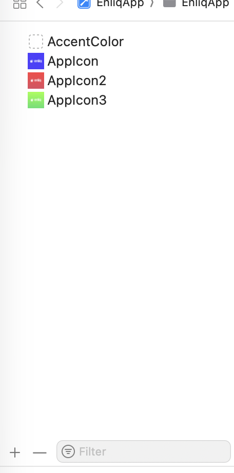

<p align="center">
  
</p>

# EIQAppIconChanger

`EIQAppIconChanger` is a lightweight Swift package that allows you to **change your app's icon at runtime**. It provides a simple, reusable, and Swift-friendly API for managing alternate app icons.

---

## Features
- ✅ Switch between multiple app icons defined in your Info.plist.
- 💡 Simple and clean API with completion callbacks.
- 📱 Works on real iOS devices (simulator not supported for icon change).
- 🛠️ Fully compatible with iOS 15+ and Swift 5.9+.

---

## Requirements
- iOS 15.0+
- Swift 5.9+
- Xcode 16.0+

> ⚠️ **Note:** App icon change is **not supported in the simulator**. Use a real device to test alternate icons.

---

## Installation

Add `EIQAppIconChanger` to your `Package.swift`:

```swift
dependencies: [
    .package(
        url: "https://github.com/loodos/enliq-utilities-ios-sdk.git",
        .upToNextMajor(from: "1.1.0")
    )
],
targets: [
    .target(
        name: "YourAppTarget",
        dependencies: [
            .product(name: "EIQAppIconChanger", package: "enliq-utilities-ios-sdk")
        ]
    )
]
```

---

## Usage

Import the package and change the app icon:

```swift
import EIQAppIconChanger
EIQAppIconChanger.shared.changeIcon(to: "YOUR_ICON_NAME") { success in
    print(success ? "Icon changed successfully ✅" : "Failed to change icon ❌")
}
```

---

## Info.plist Configuration

To enable alternate app icons, configure your `Info.plist` with the following `CFBundleIcons` dictionary:

> **Note:** The `UIPrerenderedIcon` key indicates whether iOS should apply a gloss effect to the icon.  
> Since iOS 7, this effect is ignored, but the key is still required for backwards compatibility.
```
<key>CFBundleIcons</key>
<dict>
    <key>CFBundlePrimaryIcon</key>
    <dict>
        <key>CFBundleIconFiles</key>
        <array>
            <string>AppIcon</string>
        </array>
        <key>UIPrerenderedIcon</key>
        <false/>
    </dict>
    <key>CFBundleAlternateIcons</key>
    <dict>
        <key>Icon-1</key>
        <dict>
            <key>CFBundleIconFiles</key>
            <array>
                <string>Icon-1</string>
            </array>
            <key>UIPrerenderedIcon</key>
            <false/>
        </dict>
        <key>Icon-2</key>
        <dict>
            <key>CFBundleIconFiles</key>
            <array>
                <string>Icon-2</string>
            </array>
            <key>UIPrerenderedIcon</key>
            <false/>
        </dict>
        <key>Icon-3</key>
        <dict>
            <key>CFBundleIconFiles</key>
            <array>
                <string>Icon-3</string>
            </array>
            <key>UIPrerenderedIcon</key>
            <false/>
        </dict>
    </dict>
</dict>
```

---

## Preview
<p align="center">
  
</p>

> **Note:** To display the icon correctly in the preview, make sure you select **"Include all App Icon assets"** in Xcode when adding the icon images. This ensures all sizes and scales are available.

## Example icon added to Assets
<p align="center">
  
</p>
